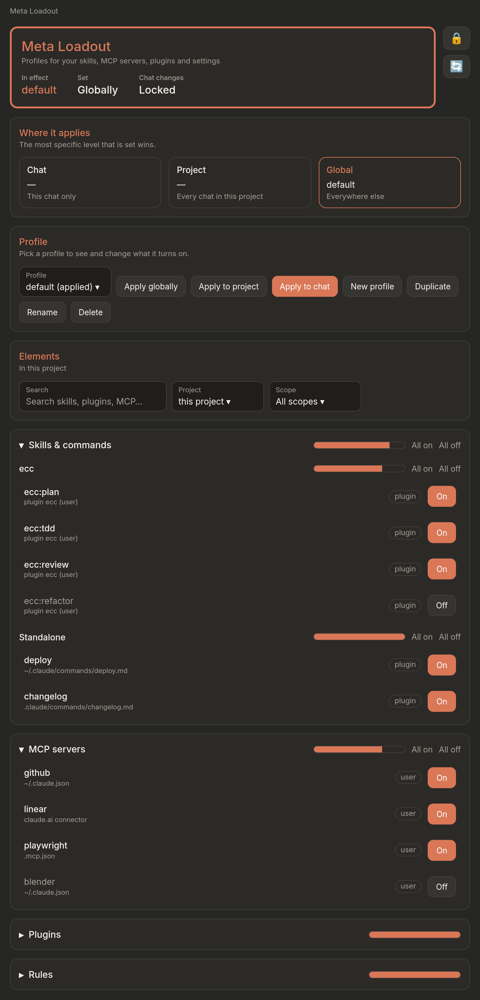
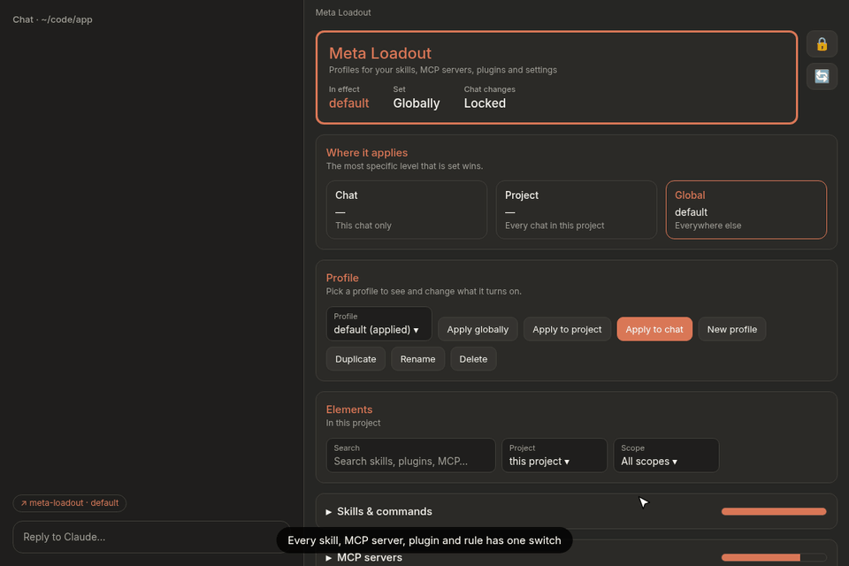
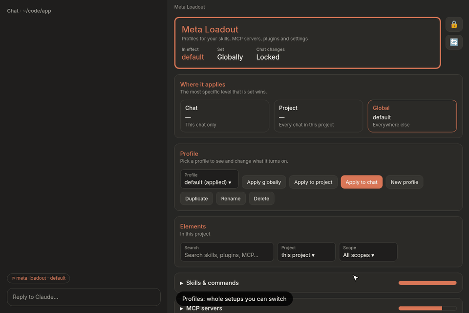
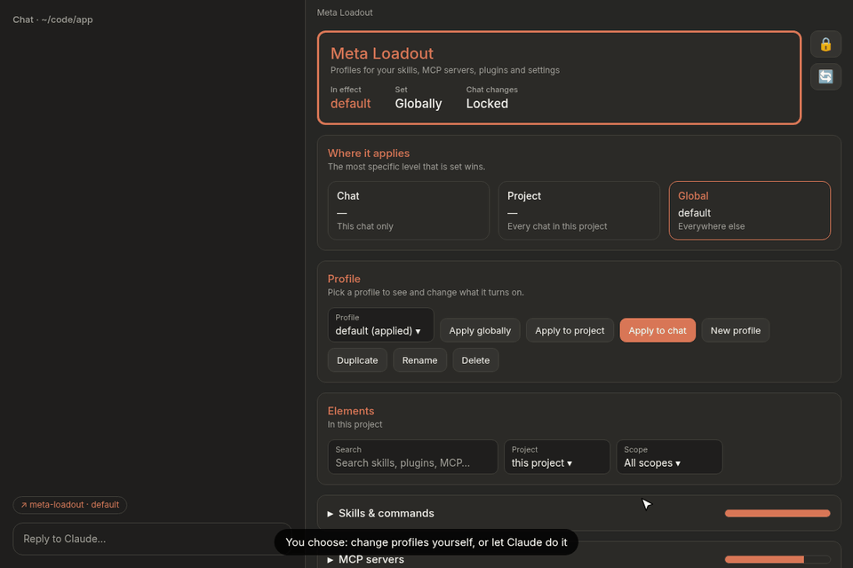
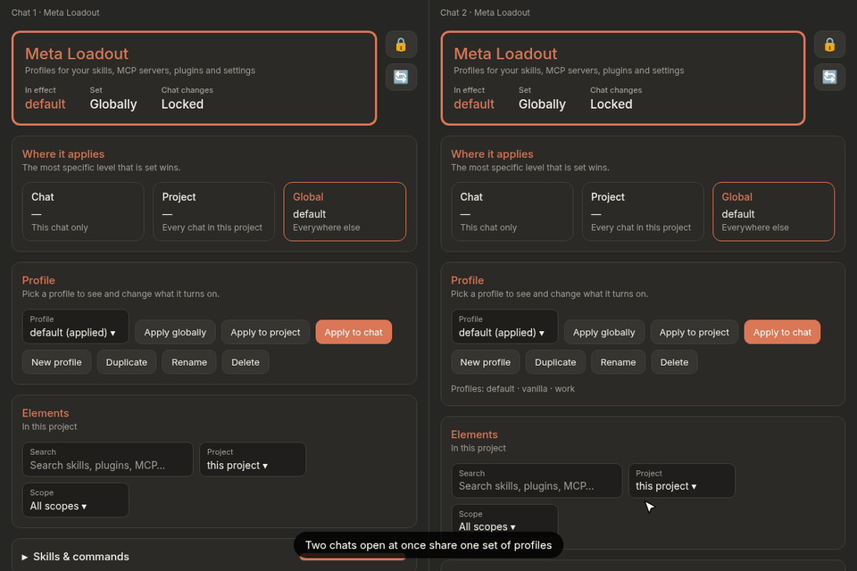

# meta-loadout

A Claude Code mod that manages your harness: every skill, rule, memory, MCP server, hook, plugin, permission and setting, with one switch each and profiles to swap whole setups. It works in the terminal and in a GUI pane for the Claude desktop app and the VS Code extension.

Based on [loadout](https://github.com/MK27MK/loadout) by Mattia Carella (MIT). meta-loadout adds:

- a desktop / VS Code GUI pane (`hooks/desktopView.tsx`)
- **All on / All off** per card (kind) and per plugin group
- **New profile** from scratch, with everything on or everything off
- a profile **per chat, per project, or globally**
- profiles shared live between open chats, and a **chat lock** that decides whether Claude may change them when you ask

<p align="center"></p>

*A mockup of the desktop pane, drawn from its layout. The images and animations below come from [`docs/mockup`](docs/mockup) and can be regenerated with `docs/mockup/record.mjs`.*

## Install

```
/plugin marketplace add sagwl96/meta-loadout
/plugin install meta-loadout@meta-loadout
```

In the Claude desktop app: **+** next to the prompt box, then Plugins, Add marketplace `sagwl96/meta-loadout`, then Add plugin.

It starts in the session you install it from: the `↗ meta-loadout` band appears above the prompt. If it does not, run `/reload-plugins`. Sessions started later load it by themselves.

### Updating

```
claude plugin update meta-loadout@meta-loadout
```

Then run `/reload-plugins` in each open session, or start a new one. Profiles, bindings and the chat lock are kept: they live in the plugin's store, not in its code.

To run it from a local clone instead:

```
claude --plugin-dir path/to/meta-loadout
```

## The pane


*The terminal pane, from the original loadout.*

`/meta-loadout` opens the pane. Elements are grouped by kind, and each row is one harness element:

```
☑ ecc:plan              plugin   plugin ecc (user)
☐ rules/testing.md      user     ~/.claude/rules/ecc/testing.md
☑ hooks.Stop            policy   locked · managed settings
```

- Press the checkbox to turn an element on or off.
- `Project` picks the project whose files are listed, `Scope` filters by scope.
- The tabs at the bottom are the profiles, with the applied one in brackets. Press a tab to look at a profile. Its `▸` menu applies, duplicates, renames or deletes it.
- `+` duplicates the profile you are looking at under a new name.
- `Refresh` reads the harness again.

Keys: Tab moves between controls, Enter presses, Esc returns to the prompt.

## Desktop app

In the Claude desktop app and the VS Code extension the pane is a GUI instead of the terminal text view. From top to bottom:

- **Status card** (orange border): the profile in effect, where it is set, and whether chat changes are locked. It only informs; beside it, 🔒 / 🔓 switches the chat lock and 🔄 reads the harness again. Hover an icon for what it does.
- **Where it applies**: what is set for this chat, this project and globally. The level in effect is outlined in orange; **Unset** removes a chat or project profile.
- **Profile**: pick a profile to look at, apply it to the chat, the project or globally, or make, duplicate, rename and delete one.
- **Elements**: search by name, origin or kind (for example `mcp` or `ecc`), and filter by project and scope. Below it, one card per kind (click its header to open it). Each card and plugin group has a progress bar of how many are on (hover it for the numbers) and **All on** / **All off**, which a search limits to the matches. Each element has a scope chip, a clickable origin and an **On** / **Off** button.

The terminal keeps the text view.



## What it manages

| Kind | Off means | Writes a file |
|---|---|---|
| CLAUDE.md, rules, memories | The file is left out of the context | No |
| Skills and commands | The command is hidden and refuses to run | No |
| Agents | The agent is not offered to the model | No |
| MCP servers | Every call to the server is denied | No |
| Hook events | All hooks of that event are skipped | No |
| Hooks in settings | The hook is removed from its `settings.json` | Yes |
| Plugins | `enabledPlugins` is set to `false` | Yes |
| Permissions | The rule is removed from its `settings.json` | Yes |
| Settings | The key is removed from its `settings.json` | Yes |

Plugin hooks can only be skipped per event, not one by one. After a plugin toggle, run `/reload-plugins`.

## Scopes

Every row shows where the element comes from:

| Scope | Source |
|---|---|
| `policy` | Managed settings of your organization. Always locked. |
| `flag` | Command-line flags. Always locked. |
| `user` | Your config directory (`~/.claude`, or `CLAUDE_CONFIG_DIR`) |
| `project` | `.claude/` and `.mcp.json` in the project |
| `local` | `.claude/settings.local.json` |
| `plugin` | An installed plugin, with the scope it was installed in |
| `account` | A claude.ai connector |
| `memory` | A memory file |
| `mixed` | A hook event with hooks from more than one scope |

## Profiles



A profile starts with everything on or everything off, and remembers the elements you toggled.

- `default`: your harness as it is.
- `vanilla`: everything off, except permissions and settings. It is built in and cannot be changed, renamed or deleted. Duplicate it to build on it.

### Per chat, per project, or globally

A profile can be applied at three levels. The most specific one that is set wins:

| Level | Applies to | Set with |
|---|---|---|
| `chat` | This chat only (kept when you resume it; a `/clear` starts a new chat) | `/meta-loadout use <profile> chat`, or **Apply to chat** |
| `project` | Every chat in the session's project folder, its `.claude/worktrees/*` included | `/meta-loadout use <profile> project`, or **Apply to project** |
| `global` | Everything else | `/meta-loadout use <profile>`, or **Apply globally** |

`/meta-loadout unset chat` or `unset project` (or **Unset** in the pane) removes a level, so the next one down takes over. The pane header shows what each level is set to, and the band says `(chat)` or `(project)` when one of those is in effect.

Settings files are shared, so each one follows the level that owns it:

- Context files, skills, agents, MCP servers and hook events follow the profile in effect for the chat.
- Entries in the project's `.claude/settings.json` and `settings.local.json` follow the project profile, or the global one when no project profile is set.
- Entries in `~/.claude/settings.json` (plugins, permissions, settings and hooks there) always follow the global profile.

A chat profile never writes a file, and two chats open in the same project can use different chat profiles without interfering. When a profile is in effect for a chat but does not own a settings file, its rows for that file show what the profile would set, and toggling them only updates the profile.

To compose a setup from several harnesses, create a profile that starts with everything off and switch on the pieces you want (in the desktop GUI: **New profile**, then **All on** per card or plugin group):

```
/meta-loadout new ecc-react off
```

## Commands

| Command | Does |
|---|---|
| `/meta-loadout` | Opens the pane |
| `/meta-loadout status` | Lists what is off in the active profile |
| `/meta-loadout list` | Lists the profiles |
| `/meta-loadout show [<profile>]` | Lists what a profile changes, the active one without a name |
| `/meta-loadout set <profile> <element> <on\|off>` | Turns one element on or off in a profile, by its name or id (as `status` and the pane show them) |
| `/meta-loadout lock` / `unlock` | Stops or allows Claude changing profiles when you ask it in chat |
| `/meta-loadout use <profile> [chat\|project\|global]` | Switches profile, globally unless a level is given |
| `/meta-loadout unset <chat\|project>` | Removes the chat or project profile |
| `/meta-loadout new <profile> [on\|off]` | Creates a profile with everything on or everything off. Without either, copies the active one. |
| `/meta-loadout rename <profile> <new name>` | Renames a profile |
| `/meta-loadout delete <profile>` | Deletes a profile |
| `/meta-loadout project [<folder>]` | Lists the files of another project folder. Without a folder, goes back to the session's project. |

### Chat lock



You choose how profiles may be changed:

- **Locked** (the default): only you change profiles, from the pane or by typing `/meta-loadout`. Claude can still read them (`list`, `status`, `show`).
- **Unlocked**: you can also ask Claude in chat ("turn off the github MCP in my work profile", "make a profile for React with only these skills") and it changes them through its `meta-loadout` tool, with the same words as the command.

Switch it with `/meta-loadout unlock` and `/meta-loadout lock`, or the **Chat changes** button in the pane. The setting is shared by every chat. Only you can switch it: Claude cannot lock or unlock it, and a `/meta-loadout` command you did not type (another session's, a model-written one) can only read.

### Several chats at once



Every chat reads the same profiles. A profile made, renamed, deleted or toggled in one chat shows in the others within a few seconds, with no restart, and a change in one chat never writes away another chat's.

## Safety

- Before the first change to a settings file, meta-loadout copies it to `<config dir>/meta-loadout-backups/`.
- A removed entry is stored and restored only into the file it came from.
- Setting values are never shown, only their keys.
- Project settings behind a symbolic link are not written.

## Development

```
claude plugin validate .
claude plugin test .
```

To run your working copy instead of the released one, install it from the folder itself:

```
claude plugin marketplace add path/to/meta-loadout
claude plugin install meta-loadout@meta-loadout
```

If the GitHub marketplace is already added, remove it first (`claude plugin marketplace remove meta-loadout`); the folder install may keep its profiles apart from the GitHub one's. A plugin from a folder marketplace is read from that folder, so after an edit `/reload-plugins` picks it up with no version bump. For a reload on every save, list the folder in `CLAUDE_CODE_PLUGIN_DIRS` instead (in the `env` block of `~/.claude/settings.json`), and in sessions the desktop app hosts also set `CLAUDE_CODE_PLUGIN_DIR_WATCH=1`. Uninstall the marketplace copy first so the mod does not load twice.

The engine does not allow `$` to cross an import, so every engine call is in `hooks/register.tsx`. The other files in `hooks/` are pure functions.

## License

[MIT](LICENSE). Original work (c) 2026 Mattia Carella; additions (c) 2026 sagwl96.
